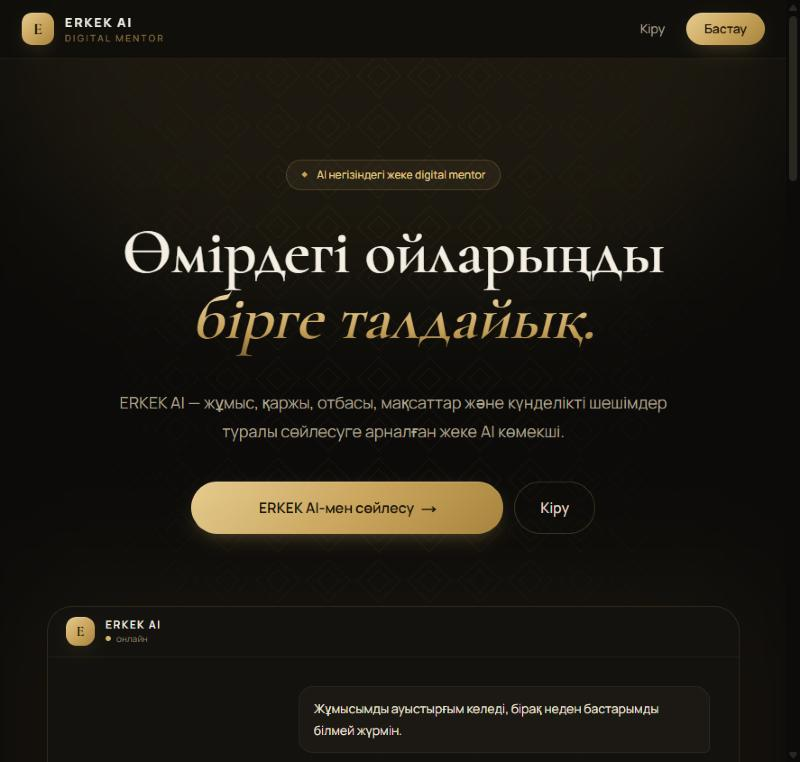

<div align="center">

# ◆ ERKEK AI

**Ер адамдарға арналған AI-негізіндегі цифрлық ментор**

[](https://github.com/safidon/ERKEK-AI/actions/workflows/ci.yml)




</div>

---

## 🧠 ERKEK AI деген не?

**ERKEK AI** — ер адамдарға өмірлік жағдайларды салқын ақылмен талдауға,
жауапкершілікті қабылдауға және нақты әрекет жасауға көмектесетін
цифрлық ментор.

ERKEK AI адамның орнына шешім қабылдамайды. Мақсаты — жағдайды түсінуге,
бақылауға болатын нәрселерді анықтауға және келесі дұрыс қадамды жасауға
көмектесу.

## ✨ Мүмкіндіктер

| | |
|---|---|
| 💬 **Чат** | Жауап stream түрінде бірден шығады, markdown, көшіру, қайта генерациялау |
| 🗂️ **Бөлек әңгімелер** | Әр тақырыпқа жеке чат, sidebar, архив |
| 🎭 **Кейіпкерлер** | Үш стиль: **Аға / Брат**, **Қатал / Жёсткий**, **Стратег** |
| 💾 **Ұзақ мерзімді жады** | Пайдаланушы туралы маңызды деректер сақталады, қайшылықтар өңделеді |
| 📝 **Summary** | Ұзақ әңгіменің қысқаша мазмұны біртіндеп жаңартылып отырады |
| 🧩 **Талдау** | Тақырып (бірнеше категория), эмоция, тіл, жауап стилі |
| ⚠️ **Қауіпсіздік** | Қауіпті жағдайларды анықтау, Қазақстанның шұғыл көмек нөмірлері |
| 🌐 **Тілдер** | Қазақша және орысша |
| 🔐 **Аккаунт** | Тіркелу, кіру, JWT, мерзімі біткенде автоматты шығу |
| 🛡️ **Production** | Rate limiting, security headers, Docker, HTTPS, backup, CI/CD |

## 🛠 Технологиялар

- **Backend:** Python 3.14, FastAPI, Pydantic, OpenAI API, SQLite (dev) / PostgreSQL (prod), JWT, Pytest
- **Frontend:** Next.js 16, React 19, TypeScript, Tailwind CSS 4
- **Инфрақұрылым:** Docker Compose, Caddy (автоматты HTTPS), GitHub Actions

## 🚀 Жергілікті іске қосу

Керек: **Python 3.14**, **Node.js 22+**, OpenAI API кілті.

### 1. Backend

```bash
cd backend
python -m venv .venv
# Windows:      .venv\Scripts\activate
# macOS/Linux:  source .venv/bin/activate
pip install -r requirements.txt

cp .env.example .env
# .env ішінде OPENAI_API_KEY және JWT_SECRET_KEY толтырыңыз
# JWT_SECRET_KEY жасау:  python -c "import secrets; print(secrets.token_hex(32))"

uvicorn app.main:app --reload
```

Backend: <http://127.0.0.1:8000> · API құжаттамасы: <http://127.0.0.1:8000/docs>

`DATABASE_URL` бос болса, SQLite қолданылады (`backend/database/erkek_ai.db`).

### 2. Frontend

```bash
cd frontend
npm install
npm run dev
```

Frontend: <http://localhost:3000>

Backend басқа адресте болса, `frontend/.env.local` ішінде
`NEXT_PUBLIC_API_URL=...` көрсетіңіз.

## 🧪 Тесттер

```bash
cd backend
python -m pytest -q
```

50 тест: категория және эмоция талдауы, жады, қауіп анықтау, prompt builder,
чат API, аутентификация, сессиялар, кейіпкерлер, rate limiting.

GitHub Actions әр push-та тесттерді **SQLite және PostgreSQL** бойынша
жүргізеді, frontend-ті build жасайды және Docker image-дерді құрастырады.

## 🌍 Production-ға орнату

Бір серверде бәрі Docker арқылы жұмыс істейді:

```text
Интернет ──► Caddy (HTTPS) ──┬── /api/* ──► backend (FastAPI) ──► PostgreSQL
                             └── /*     ──► frontend (Next.js)
backup ──► күн сайын pg_dump
```

```bash
cp deploy/.env.example deploy/.env    # домен, кілттер, құпиясөздер
docker compose --env-file deploy/.env up -d --build
```

Толық нұсқаулық (VPS, домен, мониторинг, backup, автоматты deploy):
**[deploy/README.md](deploy/README.md)**

## 🧩 Brain pipeline

```text
Хабарлама
  → Тілді анықтау
  → Жадыны жаңарту (+ қайшылықтарды шешу)
  → Категория талдауы (негізгі + қосымша)
  → Эмоция
  → Қауіп талдауы ──► жоғары қауіп: safety жауап + шұғыл көмек нөмірлері
  → Жауап стилі + таңдалған кейіпкер
  → Prompt: system prompt + жады + summary + соңғы хабарламалар
  → OpenAI (stream)
  → Сақтау + summary жаңарту
```

## 📁 Жоба құрылымы

```text
ERKEK-AI/
├── backend/
│   ├── app/
│   │   ├── auth/        # JWT, құпиясөз hash
│   │   ├── brain/       # талдау, жады, summary, қауіп
│   │   ├── core/        # config, logger, rate limit, security headers
│   │   ├── prompts/     # system prompt, кейіпкерлер
│   │   ├── routes/      # auth, chat, sessions, profile
│   │   ├── services/    # OpenAI
│   │   └── database.py  # SQLite / PostgreSQL
│   ├── tests/
│   └── Dockerfile
├── frontend/
│   ├── app/             # /, /login, /register, /chat, /settings
│   ├── lib/             # API, JWT session
│   └── Dockerfile
├── deploy/              # Caddyfile, backup, .env.example, нұсқаулық
├── .github/workflows/   # CI, Deploy
└── docker-compose.yml
```

## 🗺️ Roadmap

**Backend** — ✅ дайын: brain архитектурасы, жады, summary, архив,
талдау, қауіпсіздік қабаты, кейіпкерлер, аутентификация, тесттер.

**Frontend** — ✅ дайын: тіркелу/кіру, чат, sidebar, баптаулар,
JWT session, қорғалған беттер, logout, мобильді нұсқа.

**Production**

- [x] PostgreSQL
- [x] Rate limiting
- [x] Security hardening
- [x] Docker
- [x] CI/CD (GitHub Actions)
- [x] Мониторинг (health checks) және күнделікті backup
- [ ] VPS-ке орнату — конфигурация дайын, сервер керек
- [ ] Домен және HTTPS — DNS баптау керек, сертификатты Caddy өзі алады

## 🔒 Қауіпсіздік

Репозиторийге ешқашан салынбайды: `.env`, `deploy/.env`, `OPENAI_API_KEY`,
`JWT_SECRET_KEY`, production құпиясөздері, database файлдары.

## ⚠️ Ескерту

ERKEK AI кәсіби медициналық, психологиялық, заңдық немесе қаржылық
көмекті алмастырмайды. Қауіпті жағдайда **112** нөміріне қоңырау шалыңыз
немесе маманға жүгініңіз.

---

<div align="center">

**ERKEK AI v0.1.0-alpha** · © 2026 ERKEK AI · All rights reserved.

</div>
